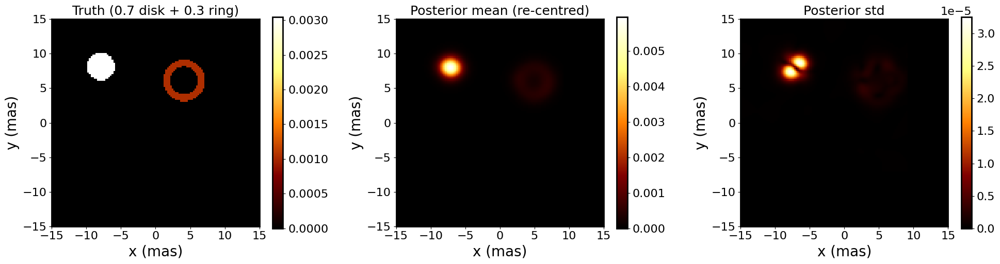
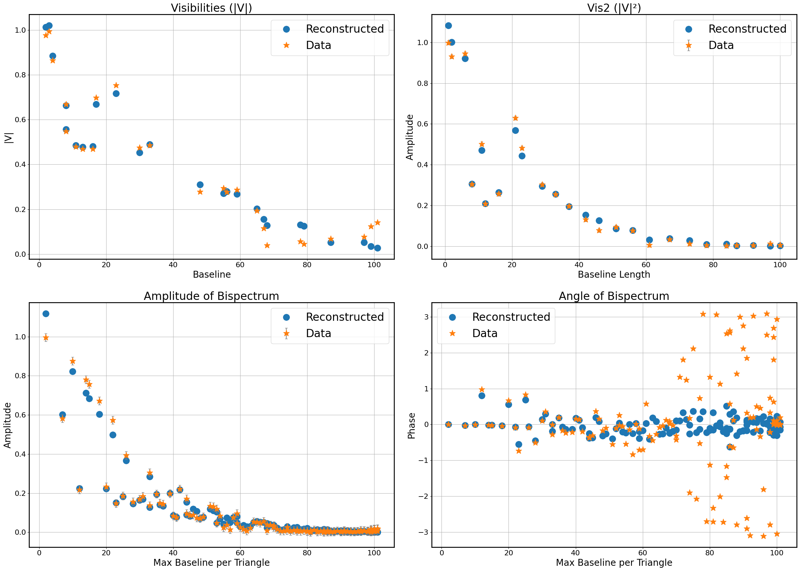
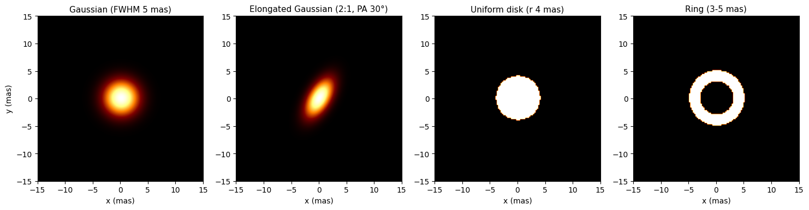
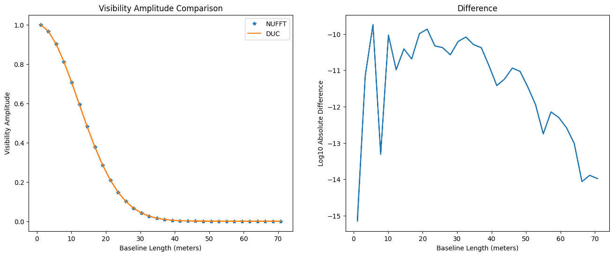

# NIFTy for Optical Interferometry — a tutorial

A hands-on tutorial on **Bayesian image reconstruction for optical/infrared long-baseline
interferometry** with [NIFTy8](https://ift.pages.mpcdf.de/nifty/) (Numerical Information Field Theory).

The notebooks build the full pipeline from scratch: reading OIFITS data, writing a NIFTy
measurement operator for interferometric visibilities, defining sky priors, constructing likelihoods
for the optical observables (squared visibilities |V|² and the bispectrum / closure phases), and running
**Metric Gaussian Variational Inference (MGVI)** to obtain a posterior mean image together with an
uncertainty map.



## Notebooks

Work through them in order:

| # | Notebook | What it covers |
|---|---|---|
| 01 | [`01_dataload`](nbs/01_dataload.ipynb) | Read an OIFITS file (`OI_VIS`, `OI_VIS2`, `OI_T3`, `OI_WAVELENGTH`) into a dictionary; plot the (u,v) coverage |
| 02 | [`02_interferometry_response`](nbs/02_interferometry_response.ipynb) | `InterferometryResponse`: a NIFTy `LinearOperator` mapping image → complex visibilities with the `ducc0` wgridder, its adjoint (dirty image) and a dot-product test |
| 03 | [`03_sky_models`](nbs/03_sky_models.ipynb) | Synthetic, flux-normalised sky models: Gaussian, elongated Gaussian, uniform disk, ring |
| 04 | [`04_nufft_check`](nbs/04_nufft_check.ipynb) | Sanity check of the Fourier step: `finufft` type-2 NUFFT vs `ducc0` `dirty2vis` (agree to ~1e-10) |
| 05 | [`05_bayesian_reconstruction`](nbs/05_bayesian_reconstruction.ipynb) | Sky priors, |V|² and bispectrum likelihoods, MGVI with `ift.optimize_kl`, posterior mean/std and data-vs-model plots |

## The model in brief

The forward model is the van Cittert–Zernike relation, evaluated on the non-uniform (u,v) points:

$$V(u,v) = \iint I(\ell,m)\, e^{-2\pi i (u\ell + vm)}\, d\ell\, dm$$

Optical interferometers rarely measure V directly because the atmosphere scrambles the phase, so
the likelihood is built from phase-robust observables:

- **squared visibilities**  |V<sub>ij</sub>|²
- **bispectrum**  B = V<sub>12</sub> V<sub>23</sub> V<sub>13</sub><sup>*</sup>, whose phase is the closure phase

The sky is modelled as $I = \exp(A\,\xi)$ with $\xi$ white Gaussian noise and $A$ a smoothing
operator (or a NIFTy `SimpleCorrelatedField`), which keeps the image positive. MGVI then approximates
the posterior over $\xi$ and returns samples, from which the mean image and the per-pixel standard
deviation follow.

## Results

**Test problem** (notebook 05): a synthetic sky made of a uniform disk (radius 2 mas, 70 % of the flux)
and a ring (2–3 mas, 30 %), observed on the (u,v) coverage of the demo OIFITS file
(1224 baselines, 6120 closure triangles, λ = 1.23 µm). |V|² (σ = 0.001) and the complex bispectrum
are simulated with Gaussian noise; the image (128 × 128 px, 30 mas field) is reconstructed from
**|V|² + bispectrum only** — no visibility phases — with 10 MGVI iterations (~1 min on a laptop CPU).

- The disk and the ring are recovered at the correct relative separation (12, −2) mas. Since |V|² and
  closure phases do not constrain the absolute position, the posterior mean is re-centred on the truth's
  photocentre for the comparison above.
- The ring is recovered as a fainter, smoothed annulus: the smoothness prior (σ = 6 px) and short run blur
  the sharp edges of the truth.
- The model reproduces the data: |V|, |V|², bispectrum amplitude, and closure phase on the short and intermediate
  triangles. At the longest baselines the data closure phases are dominated by noise, because |B| ≈ 0 there.



| Sky models (notebook 03) | NUFFT vs ducc0 (notebook 04) |
|---|---|
|  |  |

## Installation

```bash
git clone https://github.com/Chandan0107/nifty-oi-tutorial.git
cd nifty-oi-tutorial
pip install -e .          # installs the small `nifty_oi` helper package + nifty8, ducc0, finufft, astropy
jupyter lab nbs/
```

Tested with Python 3.12, nifty8 8.5, ducc0 0.35, finufft 2.4. On macOS, if you hit an
`OMP: Error #15 ... libomp` crash, run with `KMP_DUPLICATE_LIB_OK=TRUE`.

## Repository layout

```
nbs/        tutorial notebooks (source of truth, built with nbdev)
nifty_oi/   Python package exported from the notebooks (nbdev_export)
data/       Gaussian_elong.fits — synthetic OIFITS file (17-telescope demo array, λ = 1.23 µm)
figures/    figures used in this README
```

The `nifty_oi` package is generated from the notebooks with [nbdev](https://nbdev.fast.ai/): edit the
notebooks, then run `nbdev_export`.

## References

- NIFTy: Edenhofer et al., *Re-Envisioning Numerical Information Field Theory (NIFTy.re)*, JOSS 2024; [NIFTy documentation](https://ift.pages.mpcdf.de/nifty/)
- MGVI: Knollmüller & Enßlin, *Metric Gaussian Variational Inference*, arXiv:1901.11033 (2019)
- `ducc0` wgridder: Arras et al., *Efficient wide-field radio interferometry response*, A&A 646, A58 (2021)
- OIFITS: Duvert, Young & Hummel, *OIFITS 2: the 2nd version of the data exchange standard for optical interferometry*, A&A 597, A8 (2017)

## License

Apache 2.0 — see [LICENSE](LICENSE).
